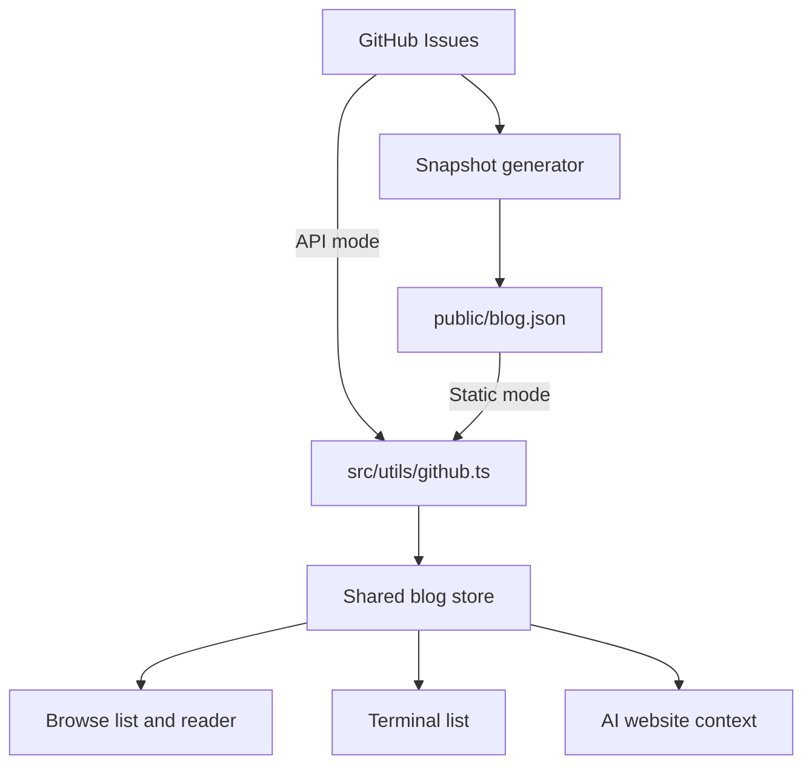

# Architecture and ownership

The website uses React and native browser behavior for both browsing and terminal
interaction.

## Entry points

| Responsibility                            | Implementation                                                                                      |
| ----------------------------------------- | --------------------------------------------------------------------------------------------------- |
| Startup and command definitions           | `src/main.tsx`, `src/commands/index.ts`                                                             |
| Theme and global styles                   | `src/App.tsx`, `src/hooks/useTheme.ts`, `src/components/styles/themes.ts`                           |
| Screen-size detection and route owner     | `src/components/Portfolio.tsx`                                                                      |
| Shared browse/terminal shell              | `src/components/PortfolioShell.tsx`                                                                 |
| Hash URLs and page scroll restoration     | `src/hooks/useBrowseNavigation.ts`                                                                  |
| Blog article rendering                    | `src/components/ArticleReader.tsx`                                                                  |
| Terminal output/history                   | `src/components/Terminal.tsx`, `src/components/CommandHistoryItem.tsx`, `src/components/Output.tsx` |
| Prompt and command menu                   | `src/components/TerminalComposer.tsx`                                                               |
| Caret measurement, selection, composition | `src/hooks/useBlockCaret.ts`                                                                        |
| Input shortcuts and command submission    | `src/hooks/useKeyboardShortcuts.ts`, `src/hooks/useCommandSubmission.ts`                            |
| Command/AI state                          | `src/stores/terminalStore.ts`                                                                       |
| Visual styling                            | `src/components/styles/`                                                                            |

## Modes and navigation

`Portfolio` detects a compact layout with
`(max-width: 767px), (max-width: 1023px) and (pointer: coarse)`.
When the URL has no hash, this chooses browse mode on compact screens and
terminal mode on desktop. `#/` explicitly means browse home; `#/terminal`
explicitly means terminal. An explicit route survives viewport changes.

`useBrowseNavigation` owns hash parsing, browser history, and page scroll
positions. Hash routes work on static hosting without server rewrites.
`BlogList` owns the browse list's category and loaded count; those and
page scroll positions are saved in session storage. `ArticleReader` restores
scroll after its lazy-loaded content mounts.

Terminal commands are resolved and executed through the command registry and
terminal store. They do not call browse navigation. Only explicit mode controls
cross between the two modes. The browse homepage supplies its own command-link
callback to `Welcome`, so the shared content can navigate in browse mode and
execute commands in terminal mode.

Browse mode renders bottom navigation without a prompt. Terminal mode renders a
prompt without bottom navigation. `/blogs` opens an interactive panel inside the
terminal; its escape/back control returns to the prompt, not to browse mode.

## Content and blog data

Personal content has one source: `src/content/siteData/`. About, projects,
contact, and welcome components consume that data. AI context also
consumes it rather than keeping a second biography.

`ProjectAlbum` owns the four-photo preview. `PhotoViewer` is the shared modal
used by project albums and contact galleries, with `TransitionPhoto` handling
load-aware crossfades.
`previewImageIds` in site data selects the lead photo and thumbnails; remaining
images come from the existing album groups. Fixed proportions reserve space before
images load. The viewer uses a native modal `dialog` for focus containment and
Escape, and restores the opener and scroll lock on close or unmount. Navigation
and swipe state stay inside the album rather than changing the page or mode.
`usePhotoGestures` handles horizontal trackpad and mouse drag navigation on the
preview cover and viewer, while leaving vertical scrolling and pinch zoom alone.
Photos crossfade after the incoming image loads. The viewer keeps a blurred,
translucent backdrop; reduced-motion preferences disable the fade.

Blog configuration is shared in `src/config/blog.ts`:

`VITE_BLOG_DATA_SOURCE=static` selects the snapshot. Otherwise the browser reads
the API. CI explicitly selects static mode. The generator requires a build-time
token and paginates all open issues with the configured blog label. The browser
API mode also paginates. Closing an issue or removing its label withdraws it on
the next successful content deployment.

The header's For agents link opens [the GitHub reading guide](READING_GUIDE.md).
`public/llms.txt` points directly to GitHub content and the guide. `index.html`
advertises it with `rel="describedby"` and includes a no-JavaScript guide link.
There is no additional content generator: Issues remain the original articles,
and Copy link shares the existing hash URL. Only root navigation can fall back
to the PWA app shell; text resources and unknown real paths reach the host.

`ArticleReader` uses react-markdown and remark-gfm. Preserve authored content and
keep links, images, tables, and code usable on small screens. Do not introduce
raw HTML execution merely to support an article's formatting.

## AI boundary

`src/commands/ai/index.tsx` builds messages from the persona, shared site content,
and blog metadata. `src/utils/content/contextBuilder.ts` owns context formatting
and approximate token budgets. `blogStore` shares article data, request status,
and in-flight requests across browse, terminal, and AI; display filters stay local.

`src/utils/llm.ts` consumes streaming responses. With `VITE_LLM_PROXY_URL`, it
calls `cloudflare/llm-proxy.ts`, which uses server-side provider credentials.
The client always uses the Worker; provider adapters and keys stay server-side. Frontend rendering, Worker reachability,
and provider authentication are separate verification scopes.

## Extending behavior

- **Content:** change `src/content/siteData/` only when content edits are requested.
- **Command:** add an entry to `src/commands/index.ts` and a component under
  `src/commands/`. This static table owns names, descriptions, argument support,
  visibility, and components. `CommandRegistry` only resolves input and looks
  up these definitions. History keeps raw input and its command/AI mode; AI
  prompts are never encoded into command arguments.
- **Browse page:** extend the route parser/type, shell rendering, navigation,
  and route tests together. Keep command execution independent.
- **Input behavior:** work through the native textarea and its existing hooks;
  verify IME, selection, history editing, and mobile focus in addition to unit tests.

There is no plugin runtime or secondary command context. Native textarea
editing owns text and selection; the terminal store owns history and AI sessions.
The theme store is the sole source for theme initialization.
